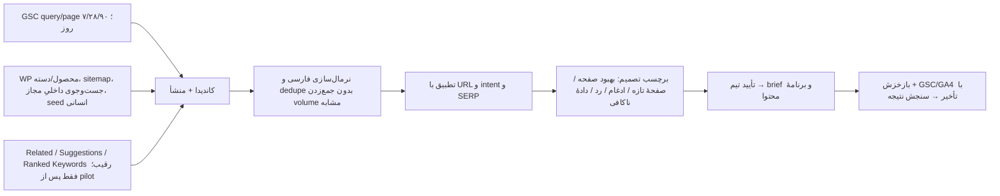

# موتور کشف کلمه و تحلیل رقیبِ صفحه در SEO Brain

وضعیت: طرح اجرایی؛ **گام صفر و بخش GSC از گام یک در شاخهٔ PR پیاده‌سازی شده‌اند، روی سرور مستقر نشده‌اند.** تاریخ بررسی: ۱۹ مهر ۱۴۰۵. این سند مکمل [کالبدشکافی ۴۸ مخزن](./reference-architecture-48.fa.md) است و بر کد همان checkoutهای ثبت‌شده در [manifest](./reference-repositories-manifest.md)، کد فعلی SEO Brain و مستندات رسمی منبع داده تکیه دارد. هدف اولیه، گردش کار تیم SEO سالیمور در بازار ایران/فارسی است؛ طراحی از ابتدا چندسایتی می‌ماند.

گام پیاده‌شده: `/sites/{site_id}/keywords/discover/gsc` عبارت‌های مشاهده‌شده و ثبت‌نشده را با صفحه، بازه و تازگی داده به UI می‌دهد؛ کاربر هر عبارت را با منشأ `gsc` ثبت یا نادیده می‌گیرد. پیشنهاد «صفحهٔ جدید» اکنون صریحاً درخواست بررسی است و نبود ردیف GSC را نبود رتبه یا تقاضا نمی‌خواند. کشف از محصول/دسته، اتصال بیرونی، SERP و مقایسهٔ رقیب هنوز در برنامهٔ اجرا هستند.

## نتیجهٔ تحقیق: چه چیزی داریم و چه چیزی کم است؟

| پرسش کاربر | وضعیت فعلی SEO Brain | هستهٔ لازم |
| --- | --- | --- |
| «چه کلمات جدیدی را هدف بگیریم؟» | `KeywordService` کلمات ذخیره/واردشده را به `gsc_query_page` وصل، خوشه‌بندی و چهار نوع فرصت می‌سازد؛ موتور کشف کلمه از محصول، بازار یا رقیب وجود ندارد. | candidate collector از GSC، موجودی صفحه/محصول، seed و منبع خارجی؛ شواهد، بازار، تاریخ و تصمیم برای هر پیشنهاد. |
| «برای همین صفحه چه رقیبی داریم؟» | `ContentBriefService` صریحاً `competitors.available=false` برمی‌گرداند. | SERP همان query/بازار/دستگاه → URLهای رقیب واقعی → مقایسهٔ صفحه‌های هم‌نوع با صفحهٔ خودمان. |
| «این پیشنهاد درست است؟» | `create_content` با نبود ردیف GSC و target URL، متن «هیچ صفحه‌ای در نتایج ندارد» می‌سازد؛ این نتیجه از GSC قابل اثبات نیست. CTR مورد انتظار نیز منحنی ثابت عمومی است. | وضعیت `not_observed` به جای `absent`، کنترل پوشش منبع، evidence link، confidence و بازبینی انسانی. |

شاهد کد فعلی: [keyword service](../../backend/seo_brain/brain/keywords/service.py)، [keyword repository](../../backend/seo_brain/brain/keywords/repository.py)، [content briefs](../../backend/seo_brain/brain/content/briefs.py). [Search Analytics API گوگل](https://developers.google.com/webmaster-tools/v1/searchanalytics/query) تضمین نمی‌کند همهٔ ردیف‌ها را بدهد؛ [سقف دادهٔ روزانه](https://developers.google.com/webmaster-tools/v1/how-tos/all-your-data?hl=en) هم وجود دارد. پس نبود یک query در GSC به معنی نبود رتبه/تقاضا نیست.

## درس‌های دقیق از مخزن‌های مرتبط

| مخزن و مسیر بررسی‌شده | الگویی که می‌گیریم | دام/محدودیتی که تکرار نمی‌کنیم |
| --- | --- | --- |
| [OpenSEO](https://github.com/every-app/open-seo)، `.agents/skills/keyword-research/SKILL.md` و `src/server/mcp/tools/get-domain-keyword-suggestions.ts` | اول queryهای GSC نزدیک صفحهٔ اول، سپس ۱ تا ۵ seed و کلمات رتبه‌دار domain/URL رقیب، بعد SERP برای intent مبهم؛ cache و تفکیک بازار. | ارقام حجم/KD را مشاهدهٔ قطعی سایت نخوانیم؛ هزینهٔ provider قبل از اجرا روشن باشد. |
| [OpenGSC](https://github.com/fenjo26/OpenGSC)، `src/lib/seo/demand.ts` و `src/app/seo-tools/analysis/page.tsx` | related → suggestions → ideas به صورت fallback؛ SERP → انتخاب URL رقیب → واکشی صفحهٔ خودی و رقبا → تحلیل gap؛ خوشه‌بندی با هم‌پوشانی URLهای SERP. | `DEMAND_LOC` این checkout ایران را ندارد و `unsupported_country` می‌دهد. منطق بازار آن را مستقیم به ایران تعمیم ندهیم. «ندیدیم در GSC» را «رقیب دارد و ما نداریم» ننامیم. |
| [RankMeFast](https://github.com/SelmiAbderrahim/rankme.fast)، `docs/keyword-research.en.md` و `docs/backlinks-competitors.en.md` | volume/KD برآوردی و تاریخ‌دار؛ preview هزینه، cache، partial result و مقایسهٔ page pair. | امتیاز دشواری را احتمال واقعی موفقیت جلوه ندهیم. |
| [RosterSEO](https://github.com/open-saas-org/RosterSeo)، `apps/docs/content/docs/seo/competitors.mdx` | scan دستی، cache با کلید بازار، snapshot قبلی و وضعیت provider نامتصل. | مستند خودش می‌گوید «keyword gap» فعلی فقط کلمات رقیب است، نه تفاضل واقعی؛ شکست lookup نیز گاهی `[]` برمی‌گرداند. خطا را با نتیجهٔ خالی یکی نکنیم. |
| [SerpTrail](https://github.com/serpapi/serptrail) | یک `search_run` برای keyword+location+depth، نگهداری نتایج و اتصال چند سایت/صفحه به همان run؛ روند تاریخی قابل بازتولید. | با هر بازکردن صفحه API پولی را دوباره صدا نزنیم؛ عمق جست‌وجو هزینه دارد. |
| [QueryLoom](https://github.com/publicusdijital-ai/queryloom)، فایل‌های تحلیل GSC | رشد query، افت محتوا، cannibalization و striking distance از دادهٔ خودمان. | GSC به‌تنهایی بازار بیرون از دیده‌شدن فعلی را کشف نمی‌کند. |

منبع بیرونی پیشنهادی فقط **adapter قابل تعویض** است. [DataForSEO Labs](https://docs.dataforseo.com/v3/dataforseo_labs-google-overview/) endpointهای related/suggestions/ideas، ranked keywords برای domain یا URL، SERP competitors و [page intersection](https://docs.dataforseo.com/v3/dataforseo_labs-google-page_intersection-live/) دارد. وجود endpoint، پوشش خوب برای فارسی/ایران را اثبات نمی‌کند. باید فهرست رسمی location/language و نمونهٔ ۲۰ query فارسیِ خودمان با خروجی واقعی سنجیده شود. اگر پوشش نبود، ستون‌های volume/KD/competitor-ranked را `unknown` می‌گذاریم و از GSC + SERP provider معتبرِ قابل آزمایش استفاده می‌کنیم. هیچ بازار پیش‌فرض US برای سایت ایرانی مجاز نیست.

## هستهٔ ۱: کشف و اولویت‌بندی کلمهٔ جدید

**کانال‌های کاندیدا:**

1. **دارایی خودمان، بدون هزینهٔ provider:** queryهای GSC با رشد تازه، جایگاه نزدیک صفحهٔ اول، افت، چند URL برای یک intent، queryهای مرتبط با صفحهٔ محصول/دسته؛ در کنار taxonomy وردپرس، عنوان/ویژگی محصول، موجودی و مشکلاتی که مشتری در پشتیبانی مطرح می‌کند. دادهٔ تماس تنها پس از حذف PII و به شکل موضوع/intent تجمیع‌شده وارد تحقیق می‌شود.
2. **تقاضای بیرونی:** seed از دسته/محصول/مسئله، related و long-tail و question variants؛ `ranked_keywords` برای URL مشخص رقیب و `page_intersection` برای شکاف احتمالی. برآورد حجم، CPC، KD و trend همراه `provider`, `market`, `language`, `observed_at` و واحد گزارش می‌شود. نزدیک‌معنی‌ها را جمع نمی‌زنیم، چون provider ممکن است آن‌ها را یک bucket حساب کند.
3. **تأیید intent:** برای نامزدهای منتخب، snapshot SERP همان بازار و دستگاه. اگر SERP غالب، مقاله/فروشگاه/مارکت‌پلیس متفاوت باشد، نوع صفحه را پیش از توصیه عوض می‌کنیم. خوشه‌بندی واژگانی فعلی غربال اولیه است؛ برای کلمات مهم، هم‌پوشانی URLهای top 10 را می‌سنجیم تا از ساخت چند صفحه برای یک intent جلوگیری شود.

**خروجی هر کاندیدا:** query خام و نرمال، sourceهای مستقل، `first_seen/last_seen`، GSC واقعی، metric تخمینی جدا، نوع intent، URL هدف یا وضعیت «هنوز تعیین نشده»، صفحه/دستهٔ مرتبط، SERP run، دلیل پیشنهاد، ابهام‌ها و تصمیم کاربر. چهار سبد UX: «فرصت سریع در صفحهٔ موجود»، «نیازمند تحقیق»، «صفحهٔ تازه با intent مستقل»، «نامناسب/تکراری». نبود GSC = `not_observed` و نبود provider = `unavailable`؛ هیچ‌کدام صفر نیستند.

**اولویت:** فیلتر قطعیِ ارتباط به کسب‌وکار، موجودی/قابلیت ارائه و تناسب intent ابتدا اعمال شود؛ سپس امتیاز نسبی بر اساس evidence strength، فرصت GSC، ارزش تجاری و تلاش/رقابت تخمینی. به‌جای یک عدد جادویی، اجزای امتیاز و داده‌های مفقود کنار هر ردیف نمایش داده شوند. ظرفیت تیم و فصل هم ورودی برنامه‌اند. افزایش رتبه تضمین نیست.

## هستهٔ ۲: تحلیل رقیب برای هر صفحهٔ موجود

ورودی از صفحهٔ خودی شروع می‌شود، نه فهرست عمومی «رقبا». گام‌ها:

1. `site_id` و URL canonical صفحه را از موجودی سایت انتخاب؛ queryهای مرتبط از GSC و کلمات هدف/بریف را به ۳ تا ۱۰ عبارتِ متمایز محدود کنیم. اگر دادهٔ GSC صفحه ناقص است، این محدودیت را نشان دهیم.
2. SERP را برای query+country+language+device+زمان ثبت کنیم. URLهای ظاهرشده رقیب **همان query** هستند؛ رقیب برند در سطح domain یک مفهوم جداست. نوع صفحه و قصد جست‌وجو را از SERP/صفحه مشخص و ۳ تا ۵ URL هم‌نوع و قابل مقایسه انتخاب کنیم؛ نامرتبط‌ها را حذف/دستی جایگزین کنیم.
3. HTML عمومی صفحه‌های منتخب را با محدودیت نرخ، robots و cache واکشی کنیم؛ URL نهایی، status، canonical، عنوان، heading، محتوای اصلی قابل مشاهده، schema، FAQ، ویژگی کالا، قیمت/موجودی قابل مشاهده و لینک داخلی/بیرونی را snapshot کنیم. خطای fetch یا صفحهٔ مسدود = «نامعلوم»، نه «فاقد ویژگی».
4. ماتریس مقایسه بسازیم: پوشش intent، سؤال/ویژگی/موجودی، اطلاعات اعتماد و تجربهٔ خرید، ساختار محتوا، schema/متا و لینک. هر ادعا باید شاهد URL + عنصر/بخش + زمان داشته باشد. عوامل off-page مانند backlink جدا باشند؛ کمبود طول متن به تنهایی gap محسوب نشود.
5. پیشنهاد `add / expand / merge / skip` را در کنار شواهد و سطح اطمینان به بریف فعلی وصل کنیم. AI فقط خلاصه و طبقه‌بندی کند؛ دادهٔ رقیب یا ویژگی محصول نسازد و متن رقبا را بازنویسی انبوه نکند. معیار [محتوای مفید گوگل](https://developers.google.com/search/docs/fundamentals/creating-helpful-content) ارزش اصیل و اطلاعات دقیق برای کاربر است.
6. پس از تأیید و اعمال تغییر، snapshot قبل/بعد را نگه داریم؛ رفع فنی را همان روز بسنجیم، تغییر GSC/GA4 را پس از دورهٔ دادهٔ کافی و با برچسب فصل/کمپین گزارش کنیم. همبستگی را «اثر قطعی تغییر» ننامیم.

در UI صفحه، یک تب **«تحقیق و رقبا»** کافی است: queryهای صفحه، آخرین SERP، سه رقیب منتخب، ماتریس شواهد، پیشنهادها و هزینه/تازگی داده در همان نما؛ drawer برای جزئیات، بدون پرش میان چند صفحه. تب **«کشف کلمات»** صف candidate و فیلتر منبع/intent/وضعیت/صفحه را دارد. نمودار روند GSC و SERP دو سری با legend و تعریف متفاوت‌اند؛ نمودار «شکاف» تعداد یافتهٔ دارای شاهد را نشان می‌دهد، نه امتیاز خیالی. برای مدیر، تعداد candidate تأییدشده، briefهای در دست اقدام، صفحات بازبینی‌شده و نتایج با مخرج پوشش نمایش داده می‌شود.

## قرارداد داده و API در پشتهٔ فعلی

این‌ها جدول‌های پیشنهادی‌اند، نه جدول‌های موجود. همهٔ کلیدها `site_id` و زمان UTC دارند؛ اجرای منبع و هزینه immutable ثبت می‌شود.

| موجودیت | فیلدهای تعیین‌کننده / تضمین |
| --- | --- |
| `research_runs` | `id, site_id, kind, scope, market, language, device, provider, status, coverage, quoted_cost, actual_cost, started_at, finished_at, error_code`؛ status: `complete/partial/capped/failed/not_configured` |
| `keyword_candidates` + `candidate_evidence` | query خام/نرمال، target URL، intent، وضعیت تصمیم؛ هر GSC row / محصول / seed / provider row شاهدی مستقل با `source_run_id`, `observed_at`, `raw_ref` |
| `serp_runs` + `serp_results` | یکتا بر query نرمال + market + language + device + عمق + زمان run؛ نتیجه شامل rank، type، URL، title، provider؛ چند سایت از یک run بخوانند. |
| `competitor_pages` + `page_comparisons` | snapshot URL/status/hash/fetched_at و نسخهٔ استخراج؛ مقایسه با `own_url`, `query_set`, `serp_run_ids`, findings، evidence و وضعیت بررسی. |
| `research_decisions` | `candidate/comparison_id`, `decision`, actor، reason، زمان؛ تاریخچهٔ رد/تأیید و اتصال به brief/content item. |

API پیشنهادی: `POST /sites/{id}/research/keyword-runs/quote`, `POST .../keyword-runs`, `GET .../candidates`, `PATCH .../candidates/{id}/decision`, `POST /sites/{id}/pages/{url_id}/competitors/quote`, `POST .../comparisons`, `GET .../comparisons/{id}`. `quote` بدون تماس پولی؛ اجرای پولی با سقف روزانه/ماهانه و idempotency key. کلید provider فقط سمت سرور؛ API هم دسترسی سایت را اعمال کند. refresh خودکار فقط برای دادهٔ رایگان یا budget تأییدشده؛ صفحه‌دیدن خرج نکند. فایل خام با retention و سطح دسترسی مشخص ذخیره شود.

## برنامهٔ اجرا و دروازهٔ پذیرش

| گام | تحویل قابل استفاده | آزمون پذیرش |
| --- | --- | --- |
| ۰. اصلاح حقیقت داده | متن/منطق `create_content` و DTOهای GSC به `not_observed`؛ نمایش `unknown` و freshness | keyword بدون ردیف GSC دیگر ادعای «هیچ صفحه‌ای ندارد» نکند؛ دادهٔ fail/partial صفر نشود. |
| ۱. MVP بدون هزینهٔ بیرونی | جمع‌کردن candidate از GSC، محصول/دسته/WP و seed؛ dedupe فارسی، اتصال به URL، صف تأیید در UI | برای هر candidate منشأ قابل کلیک و run/بازه؛ تکرار run کاندیدای دوبل ندهد؛ صفحهٔ بی‌داده وضعیت روشن دارد. |
| ۲. پایلوت ایران/فارسی | capability probe دو providerِ کلمه/SERP روی ۲۰ query نماینده، چند URL محصول/دسته و desktop/mobile؛ گزارش پوشش، کیفیت، هزینه و خطا | هیچ fallback مخفی به US؛ اگر پوشش/کیفیت ناکافی بود provider تولیدی خاموش بماند؛ جدول تصمیم بر اساس نمونه و هزینه منتشر شود. |
| ۳. snapshot رقیب | SERP run مشترک، انتخاب URL هم‌نوع، fetch و مقایسهٔ ساختاری دارای evidence | SERP و GSC تفکیک؛ fetch شکست‌خورده gap نسازد؛ page comparison با snapshot دوباره بازتولید شود. |
| ۴. اقدام و سنجش | candidate/gap تأییدشده → بریف محتوا/کار → قبل و بعد → گزارش دوره‌ای | پیشنهاد بی‌شاهد به کار اجرایی تبدیل نشود؛ نتیجهٔ فنی و تغییر ترافیک جدا، با بازه و مخرج نمایش داده شوند. |

در انتهای گام ۲، تصمیم provider یک **دروازهٔ واقعی** است. خرید داده یا وعدهٔ «تحلیل همهٔ رقبا» پیش از اثبات پوشش ایران/فارسی نکنیم. کد/مجوز مخزن‌های مرجع هم پیش از هر برداشت کد جداگانه بررسی شود؛ این سند الگوی معماری و UX می‌گیرد، نه کپی‌کردن ۴۸ پشته.

## نمونهٔ تصمیمی که ابزار باید بسازد

برای یک صفحهٔ دستهٔ سالیمور: ابتدا queryهای واقعی همان URL از GSC و کالاهای موجود را نشان دهد. سپس کاندیداهای مرتبط را در «بهبود همین صفحه» یا «intent جدا» بگذارد. روی یک query منتخب، snapshot SERP ایران/فارسی نشان دهد که چه **URLهایی** واقعاً برای آن دیده شدند؛ فقط صفحات دستهٔ قابل مقایسه را وارد ماتریس کند. اگر رقیب پرسش/ویژگی مفیدی دارد که صفحهٔ ما ندارد، خروجی دقیقاً «چه چیزی، در کدام URL/بخش، با چه اطمینانی و چرا برای کاربر مفید است» باشد؛ اگر provider بازار را پوشش نمی‌دهد، «دادهٔ رقیب در دسترس نیست» دیده شود. این مثال گردش کار است و رتبه/رقیب/حجم واقعیِ اندازه‌گیری‌نشده را ادعا نمی‌کند.
