# کالبدشکافی معماری ۴۸ مخزن و نقشهٔ ساخت SEO Brain

وضعیت: طرح معماری و برنامهٔ اجرا، نه ادعای ادغام مخزن‌ها. مبنا: ۱۹ مهر ۱۴۰۵؛ نسخهٔ دقیق هر مخزن در [manifest](./reference-repositories-manifest.md) و checkout محلی در `C:\Users\saleh\Claude\Projects\seo-brain-reference-repos\manifest.json` ثبت شده است. این بررسی بر ساختار کد، README، اسناد معماری و چند مسیر اصلی همان checkoutها استوار است. هیچ‌یک از ۴۸ برنامه در محیط تولید SEO Brain اجرا یا بنچمارک نشده‌اند. «قابلیتِ README» در جدول زیر با «قابلیتِ اثبات‌شده در تولید ما» برابر نیست.

## نتیجهٔ اجرایی

این ۴۸ مخزن ۴۸ سرویس لازم برای نصب نیستند. بیشترشان پیاده‌سازی‌های متفاوتِ شش چرخه‌اند: **کشف صفحه → جمع‌آوری داده → تشخیص → تصمیم → اجرا → سنجش نتیجه**. هستهٔ هدف SEO Brain باید این چرخه را برای هر سایت با شناسهٔ پایدار، زمان، پوشش داده و مسئول تصمیم به هم وصل کند. اولویت تیم داخلی است؛ نمای مشتری از همین مدل داده ساخته می‌شود. راهبرد پیشنهادی، توسعهٔ ماژول‌های بومی در FastAPI/Next.js فعلی و استفادهٔ محدود از کتابخانه/ابزار مستقل پس از آزمون است. کپی کل پشتهٔ Plane، OpenGSC یا OpenSEO، هم داده را دوپاره می‌کند و هم هزینهٔ عملیات را بالا می‌برد.

برای طراحی دقیق مسیر «کشف کلمهٔ جدید → بررسی رقیبِ هر URL → بریف → سنجش»، [طرح اجرایی تحقیق کلمات و رقبا](./keyword-discovery-competitor-intelligence.fa.md) را ببینید؛ این بخش پوشش بازار فارسی، منشأ شواهد و سقف هزینه را هم مشخص می‌کند.

در شاخهٔ فعلی `codex/salimore-seo-first`، خزش، `crawl_runs/pages/links`، همگام‌سازی GSC و GA4، گراف، پیشنهاد محتوا و صف محلی وجود دارند. **جدول یا API عمومی `work_items` برای تسک تیمی در این شاخه پیدا نشد**؛ `content_items` و `content_task_id`، مدیریت کار تیمی کامل نیستند. بنابراین اتصال یافته به کار تیمی یک توسعهٔ جدید است، نه اتصال ساده به «تسک موجود». تحلیل فعلی در `_clear` ردیف‌های مشکلات و فرصت‌های سایت را قبل از ساخت snapshot بعدی حذف می‌کند؛ این read model برای تاریخچهٔ پرونده و گزارش روند کافی نیست. احراز هویت API هم فعلاً `X-API-Token` مشترک است، نه هویت هر کاربر. صف JSON فعلی در یک فرایند بازیابی می‌شود، اما lease توزیع‌شده و تضمین اجرای دقیقاً یک‌بار ندارد. وضعیت از [migrations](../../database/migrations/0001_init.sql)، [analysis/seo.py](../../backend/seo_brain/analysis/seo.py)، [deps.py](../../backend/seo_brain/api/deps.py)، [queue.py](../../backend/seo_brain/automation/queue.py) و [orchestrator.py](../../backend/seo_brain/wordpress/orchestrator.py) قابل بازبینی است.

## معماری مقصد و مرز هسته‌ها

```mermaid
flowchart LR
  A[اتصال و مجوز منبع<br/>GSC / GA4 / WP / sitemap / HTML / logs / SERP] --> B[اجرای منبع<br/>run, checkpoint, coverage, cost, error]
  B --> C[موجودی URL و موجودیت<br/>canonical cluster, query, market, content]
  C --> D[مشاهدهٔ تغییرناپذیر<br/>source, time, raw ref, confidence]
  D --> E[قواعد و پروندهٔ مسئله<br/>dedupe, root cause, affected URLs]
  E --> F[صف تصمیم<br/>accept / reject / need evidence]
  F --> G[کار تیمی و تغییر کنترل‌شده<br/>owner, approval, audit, rollback]
  G --> H[راستی‌آزمایی فنی و اثر<br/>before/after, delayed GSC/GA4]
  H --> I[نما و گزارش<br/>portfolio, URL, team, client]
  I --> F
```

| هسته | مرز مسئولیت | ورودی/خروجی قراردادی | منابع اصلی الهام |
| --- | --- | --- | --- |
| ۱. اتصال و اجرا | دسترسی، quota، retry، وضعیت واقعی job؛ جداسازی `graph_only` از همگام‌سازی کامل | `source_run` با `site_id`, `stage`, `status`, `coverage`, `error_code`, `cost`, `started/finished_at` | OpenSEO، RankMeFast، OpenGSC، OpenCited |
| ۲. فهرست سایت | ادغام URLهای sitemap/WP/crawl/GSC بدون حذف منشأ؛ خوشهٔ canonical و زمان مشاهده | `url_inventory`, `url_source_membership`, `canonical_relation` | SiteOne، advertools، SEOCORE، OpenSEO |
| ۳. دفتر شواهد | مشاهدهٔ immutable و قابل بازتولید؛ GSC position را با رتبهٔ SERP یکی نکند | `observation(source_run_id, entity_id, metric, value, observed_at, coverage, raw_ref)` | OpenGSC، SerpTrail، QueryLoom، web-vitals |
| ۴. موتور تشخیص | rule قطعی جدا از heuristic؛ کلید پایدار، شدت، شواهد موافق/مخالف | `issue_case`, `case_signal`, `rule_version`, `first/last_seen` | SEOCORE، SEOnaut، Houtini، seo-audit-skill |
| ۵. صف تصمیم و کار | انسان تصمیم می‌گیرد کدام یافته به پروژه/تسک تبدیل شود؛ مالکیت و گفت‌وگو/تأیید ثبت می‌شود | `action_candidate → work_item → review → done` با audit event | Ansvisor، RankMeFast، Plane، Vikunja، OpenProject |
| ۶. سنجش نتیجه و BI | رفع فنی فوری از اثر جست‌وجوی تأخیری جدا؛ KPI با مخرج، بازه، منبع و freshness | `verification`, `metric_snapshot`, `report_snapshot` | Lighthouse CI، Client Reporter، Metabase، Langfuse |

قانون اتصال: هر عدد نمایش‌داده‌شده باید از روی `site_id → source_run → observation → rule/case → action/work → verification` قابل ردیابی باشد. اگر یکی از حلقه‌ها غایب است، UI باید «داده نداریم/پوشش ناقص/منتظر داده» نشان دهد؛ صفر ساختگی نسازد. `source_run` واحد مشترک همهٔ اتصال‌هاست، اما raw response هر منبع با retention و دسترسی جدا ذخیره می‌شود. رویدادهای work و approval append-only هستند؛ نمای جاری از آخرین رویداد محاسبه یا materialize می‌شود.

### قراردادهای عملیاتی که قبل از نمودار لازم‌اند

- **شناسه و دامنه:** `site_id` در همهٔ factها و permissionها اجباری؛ URL با تابع نرمال‌سازی نسخه‌دار، URL خام و redirect chain نگهداری شود. canonical اعلام‌شدهٔ صفحه، canonical انتخابی گوگل و URL نهایی HTTP سه فیلد جدا هستند.
- **پوشش:** run می‌تواند `complete`, `partial`, `capped`, `failed`, `skipped` باشد. «URL در خزش دیده نشد» فقط پس از خزش کاملِ همان scope می‌تواند شاهد حذف/مشکل باشد. snapshot سایت‌مپ باید تعداد seed، موفق، خطا و صف باقیمانده را داشته باشد.
- **زمان:** `event_at`, `observed_at`, `ingested_at`, `period_start/end` جدا باشند؛ GSC/GA4 با تأخیر می‌آیند. تقویم شمسی/میلادی فقط نمایش است؛ ذخیرهٔ زمان UTC/ISO و timezone منبع.
- **هزینه و منشأ:** SERP، بک‌لینک، حجم جست‌وجو و AI visibility نیازمند منبع دارای مجوز/هزینه‌اند؛ provider، بازار، دستگاه، locale، نسخهٔ مدل/prompt، quota و پول مصرفی روی هر run ثبت شود.
- **امنیت و عملیات:** idempotency key، heartbeat، lease/reconciliation و backoff برای کارهای طولانی؛ قفل سطح سایت برای خزش/همگام‌سازی؛ کنترل مجوز در API، نه فقط UI؛ تغییر وردپرس با capability probe، diff، audit و rollback.
- **تحلیل اثر:** `technical_verified` به معنی رشد سئو نیست. اثر کلیک/تبدیل با بازهٔ قبل/بعد، seasonality و تغییرات هم‌زمان برچسب بخورد؛ ادعای علیت خودکار نکنیم.

## نقشهٔ تک‌تک ۴۸ مخزن

در ستون «مسیر شاهد»، مسیر داخل checkout همان مخزن است؛ همراه با commit در manifest، بررسی را بازتولیدپذیر می‌کند. تصمیم «الگو» یعنی بازطراحی قرارداد/UX، نه انتقال کد. «ابزار اختیاری» یعنی ابتدا یک pilot و مقایسه با هستهٔ فعلی.

### A. هستهٔ خزش، مشاهده و audit (۱–۱۱، ۱۴–۱۵، ۲۴–۲۵، ۲۹–۳۰، ۴۰–۴۳)

| # و مخزن | هدف و معماری رسیدن به آن | مسیر شاهد | استفادهٔ دقیق در SEO Brain |
| --- | --- | --- | --- |
| ۱ [OpenSEO](https://github.com/every-app/open-seo) | audit بزرگ با control plane Workflow و frontier/edge/page mirror در SQLite Durable Object جدا؛ chunk، lease و نتیجهٔ جزئی | `docs/maintainers/specs/0009-site-audit-crawl-architecture.md`, `src/` | **الگو:** frontier پایدار، خطای طبقه‌بندی‌شده، partial result و تست fixture؛ Cloudflare DO را وارد پشتهٔ Python نکنیم. |
| ۴ [CrawlSEO](https://github.com/crawlseo/crawlseo) | جمع GSC، crawl، PageSpeed و فرصت در اپ Next/Prisma با workerهای محدود | `lib/crawler`, `lib/google`, `lib/workers`, `prisma/` | **UX صفحه و اتصال:** نمایش سادهٔ health صفحه؛ crawler و جدول موازی نسازیم. |
| ۸ [SiteOne Crawler](https://github.com/janreges/siteone-crawler) | crawler مستقل Rust با موتور، renderer، تحلیل و exporter جدا | `src/engine`, `src/browser`, `src/analysis`, `src/export` | **ابزار اختیاری:** نمونهٔ مقایسهٔ crawl بزرگ؛ خروجی به schema مشاهدهٔ خودمان تبدیل شود. |
| ۹ [Unlighthouse](https://github.com/harlan-zw/unlighthouse) | انتخاب URL و اجرای Lighthouse در مقیاس سایت با CLI/core/server/client | `packages/core`, `packages/cli`, `packages/server` | **ابزار اختیاری:** نمونه‌گیری lab به‌جای اجرای همهٔ صفحات؛ با RUM یکی نشود. |
| ۱۰ [Houtini SEO Audit](https://github.com/houtini-ai/seo-audit) | audit با seed از سایت‌مپ، لینک و GSC؛ خروجی دارای شاهد/MCP | `src/audit`, `src/core`, `src/generators` | **الگو:** finding با source و evidence؛ ruleها با fixture محلی تایید شوند. |
| ۱۱ [SEO Audit Skill](https://github.com/seo-skills/seo-audit-skill) | taxonomy و ruleهای قابل اجرای crawler/CLI و reporter | `src/rules`, `src/categories`, `src/reporters` | **فهرست قواعد:** فقط ruleهایی با دادهٔ موجود و نرخ خطای قابل اندازه‌گیری. |
| ۱۴ [GoCrawl](https://github.com/Patience-dot-devl/gocrawl) | runner/frontier با analyzerهای افزونه‌ای و diff/export | `internal/crawler`, `internal/analyze`, `internal/diff` | **الگو:** interface analyzer و مقایسهٔ snapshot؛ برای runtime فعلی لازم نیست. |
| ۱۵ [CrawlObserver](https://github.com/SEObserver/crawlobserver) | Go crawler/frontier/renderer و تحلیل کلان در ClickHouse | `internal/frontier`, `internal/crawler`, `internal/clickhouse` | **الگو:** جداکردن crawl داغ از انبار تحلیلی؛ ClickHouse فقط پس از حجم واقعی و بررسی AGPL. |
| ۲۴ [Lighthouse CI](https://github.com/GoogleChrome/lighthouse-ci) | CLI + server/viewer برای history و gate انتشار | `packages/cli`, `packages/server`, `packages/viewer` | **ابزار اختیاری:** gate عملکرد صفحات نمونه در CI و ثبت نسخهٔ انتشار. |
| ۲۵ [Lighthouse](https://github.com/GoogleChrome/lighthouse) | موتور جمع‌آوری و audit آزمایشگاهی با گزارش | `core/gather`, `core/audits`, `report` | **منبع lab:** امتیاز آزمایشگاهی را با CWV میدانی و URL واقعی تفکیک کنیم. |
| ۲۹ [SEOnaut](https://github.com/StJudeWasHere/seonaut) | خزش Go → issue/severity → گزارش سادهٔ هر سایت | `internal/crawler`, `internal/issues`, `internal/repository` | **الگو:** severity و تفکیک مسئله از صفحه؛ مدل SQL مستقل وارد نشود. |
| ۳۰ [LibreCrawl](https://github.com/PhialsBasement/LibreCrawl) | sessionهای چندکاربرهٔ خزش و ذخیرهٔ عناصر SEO | `src/core`, `web/` | **مرجع ایزوله‌سازی:** pilot در concurrency، نه جایگزینی بی‌دلیل crawler فعلی. |
| ۳۲ [advertools](https://github.com/eliasdabbas/advertools) | کتابخانهٔ Python برای sitemap، robots، log و تحلیل داده | `advertools/`, `tests/` | **کتابخانهٔ اختیاری:** آزمایش parser/تحلیل log پشت adapter کوچک؛ وابستگی کامل فقط در صورت ارزش اندازه‌گیری‌شده. |
| ۳۸ [Spider-Lens](https://github.com/GDM-Pixel/spider-lens) | ورود لاگ سرور/افزونهٔ WP → bot events/status/TTFB → UI/MCP | `server/services`, `server/db`, `wp-plugin/` | **الگو:** مشاهدهٔ Googlebot واقعی؛ حذف IP/PII و دسترسی لاگ پیش‌نیاز است. |
| ۴۰ [web-vitals](https://github.com/GoogleChrome/web-vitals) | SDK مرورگر برای LCP/INP/CLS و attribution | `src/attribution`, `src/lib` | **کتابخانهٔ اختیاری:** RUM با sample rate، رضایت و aggregation؛ جدا از Lighthouse. |
| ۴۱ [Mapping Website Internal Links](https://github.com/devbret/mapping-website-internal-links) | استخراج لینک داخلی → گراف D3 و امتیاز صفحه | `app.py` | **الگو:** orphan/depth/مرکزیت با گراف فعلی SEO Brain، نه دیتابیس دوم. |
| ۴۲ [Link Graph Explorer](https://github.com/ruslan2027/link-graph-explorer-oss) | crawl → `data.json` → نمایش تعاملی سبک | `api/`, `tools/` | **UX:** فیلتر سایت، depth و گروه؛ layout محدود و lazy loading برای سیستم ضعیف. |
| ۴۳ [SEOCORE](https://github.com/codepurse/SEOCORE) | monorepo: crawler/analyzer → rule compiler → scoring/graph → reporter | `packages/crawler`, `packages/engine`, `packages/rules*`, `packages/reporter` | **الگوی اصلی rule engine:** rule نسخه‌دار و تست‌پذیر؛ امتیاز کلان فقط با مخرج و پوشش داده. |

### B. دادهٔ جست‌وجو، رتبه و فرصت (۲، ۵–۷، ۱۳، ۳۳–۳۶، ۴۶، ۴۸)

| # و مخزن | هدف و معماری رسیدن به آن | مسیر شاهد | استفادهٔ دقیق در SEO Brain |
| --- | --- | --- | --- |
| ۲ [RankMeFast](https://github.com/SelmiAbderrahim/rankme.fast) | API/worker جدا با registry ارائه‌دهنده، cache و Next Actions با history؛ منابع خارجی به خروجی هم‌شکل تبدیل می‌شوند | `server/src/shared/providers`, `server/src/shared/vendor-cache`, `server/src/app.ts` | **الگوی اصلی provider و اقدام:** error taxonomy/cost/cache؛ پشتهٔ چنددیتابیسی و کد AGPL وارد نشود. |
| ۵ [Bisibility](https://github.com/CorgiCorner/bisibility) | domain overview/rank history و AI visibility با worker intents و Prisma | `lib/domain-overview`, `lib/worker-intents`, `prisma/schema` | **الگو:** snapshot و budget؛ Temporal/چندسرویس را پیش از نیاز واقعی نیاوریم. |
| ۶ [OpenGSC](https://github.com/fenjo26/OpenGSC) | اپ Next+SQLite با GSC/GA4، site inventory، rank/AEO و jobs در همان پردازه؛ workspace permission روی owner data | `docs/ARCHITECTURE.md`, `prisma/schema.prisma` | **الگو:** جدایی identity از Google grant، backup پیش از migration، job heartbeat؛ job داخل process و indexer/cloaking را تکرار نکنیم. |
| ۷ [SerpBear](https://github.com/towfiqi/serpbear) | keyword/domain → scraper/provider → rank snapshot و alert | `services/`, `scrapers/`, `database/` | **الگو:** رتبهٔ لحظه‌ای کنار GSC با برچسب جدا؛ هزینه/محدودیت منبع سنجیده شود. |
| ۱۳ [Site Analytics Tool](https://github.com/jafforgehq/site-analytics-tool) | چند سایت/اتصال GA4/GSC/Bing و view سلامت sync | `src/features`, `src/lib`, `supabase/` | **UX پورتفولیو:** تازگی داده و خطای اتصال در بالای گزارش. |
| ۳۳ [google-searchconsole](https://github.com/joshcarty/google-searchconsole) | wrapper Python برای Search Console و خروجی تحلیلی | `src/searchconsole/` | **مرجع API/test:** فقط اگر کلاینت بومی GSC نقص مشخص دارد؛ دو client زنده ایجاد نکنیم. |
| ۳۴ [seo-keyword-clusters](https://github.com/jfaccioli/seo-keyword-clusters) | prototype خوشه‌بندی عبارت‌ها | root scripts/README | **ایده:** clustering با queryهای واقعی GSC؛ نسخه legacy و مجوز نامشخص، کپی نشود. |
| ۳۵ [OpenSERP](https://github.com/karust/openserp) | adapter چند موتور با browser/fingerprint/region و API یکنواخت | `core/browser`, `core/region`, `engines/` | **pilot محدود:** صحت geo/device و نرخ شکست؛ هزینه/شرایط سرویس پیش از عملیاتی‌سازی. |
| ۳۶ [SerpTrail](https://github.com/serpapi/serptrail) | keyword+location مستقل از سایت → Solid Queue → snapshot کل SERP؛ سایت‌های متعدد به یک run وصل می‌شوند | `app/jobs`, `app/models`, `app/services` | **الگوی اصلی rank store:** یک درخواست برای چند سایت و برآورد credit؛ provider پولی و تفکیک organic/AI Overview. |
| ۴۶ [QueryLoom](https://github.com/publicusdijital-ai/queryloom) | export/API GSC → قواعد CTR پایین، striking distance، decay و mismatch → action | `scripts/`, `docs/` | **اولویت فوری:** ruleهای توضیح‌پذیر روی GSC موجود، با آستانه و بازهٔ قابل تنظیم. |
| ۴۸ [SearchMirror](https://github.com/databluedev/searchmirror) | Django/Mongo + provider SERP → rank/competitor/AI + تیم | `backend/tracker`, `backend/serp`, `backend/team_management` | **مرجع مدل:** snapshot بازار/مجوز؛ AGPL و وابستگی vendor و پشتهٔ قدیمی مانع کپی مستقیم. |

### C. AI visibility، محتوا و رفتار مدل (۳، ۱۲، ۱۷–۱۹، ۲۶، ۳۷، ۳۹، ۴۷)

| # و مخزن | هدف و معماری رسیدن به آن | مسیر شاهد | استفادهٔ دقیق در SEO Brain |
| --- | --- | --- | --- |
| ۳ [Ansvisor](https://github.com/ansvisor/ansvisor) | tracking پاسخ/رقیب → signal → action candidate → task، با worker و منبع دادهٔ جدا | `server/src/workers`, `server/src/lib/action-center`, `server/src/routes` | **الگوی اصلی lifecycle اقدام:** یافتهٔ خام فوراً تسک نشود؛ رأی/ظرفیت تیم ثبت شود. |
| ۱۲ [Aperture](https://github.com/anyin-ai/aperture) | backend/frontend برای پرسش‌های AI و visibility چند منبع | `backend/app`, `frontend/` | **نمونهٔ pilot:** تعریف prompt cohort و تکرار؛ score بدون پاسخ خام و نمونه کافی نگیریم. |
| ۱۷ [RosterSEO](https://github.com/open-saas-org/RosterSeo) | web/worker/MCP جدا برای audit، research و انتشار | `apps/web`, `apps/worker`, `apps/mcp-server` | **مرجع orchestration:** انتشار باید قابلیت و review داشته باشد؛ پروژهٔ جوان را با دادهٔ واقعی بسنجیم. |
| ۱۸ [seo-os](https://github.com/AgriciDaniel/seo-os) | workflow آژانسی/agent بر اپ واحد | `src/app`, `src/lib`, `src/store` | **ایدهٔ UX:** مأموریت و وضعیت، نه agent خودکار بدون شواهد؛ AGPL. |
| ۱۹ [SEO Panel](https://github.com/seopanel/Seo-Panel) | ابزار سنتی SEO با controller/API مستقل | `controllers/`, `api/`, `includes/` | **چک‌لیست دامنه:** قابلیت‌های کلاسیک؛ معماری PHP/GPL برای هستهٔ فعلی مناسب نیست. |
| ۲۶ [Langfuse](https://github.com/langfuse/langfuse) | ثبت trace/prompt/eval/cost برای فراخوانی‌های LLM در web/worker | `web/`, `worker/`, `packages/shared` | **الگو یا سرویس جدا:** نسخهٔ prompt، هزینه و خطای مدل؛ دادهٔ حساس و مجوز ترکیبی بررسی شود. |
| ۳۷ [OpenCited](https://github.com/opencited/opencited) | adapter چند provider → queue مجزای هر provider → پاسخ خام و reference با `kind` → امتیاز ذکر | `docs/adr/0003-multi-provider-architecture.md`, `apps/worker`, `packages/browser-crawler` | **الگوی اصلی AI evidence:** inline link و source panel جدا؛ نرخ و هزینه به‌ازای provider؛ root LICENSE روشن نیست. |
| ۳۹ [Elmo](https://github.com/elmohq/elmo) | worker/CLI/web برای ذخیرهٔ پاسخ، citation و مقایسهٔ رقیب | `apps/worker`, `apps/cli`, `apps/web` | **الگو:** پاسخ خام و citation قابل بازبینی؛ اول cohort ثابتِ prompt/locale/مدل. |
| ۴۷ [AiCMO](https://github.com/AICMO/ai-cmo) | backend/frontend برای پایش AI SEO و پیشنهاد | `backend/app`, `frontend/` | **UX مرجع محدود:** شواهد و تکرارپذیری روش قبل از score یا توصیه. |

### D. تیم، پروژه، گزارش و وردپرس (۱۶، ۲۰–۲۳، ۲۷–۲۸، ۳۱، ۴۴–۴۵)

| # و مخزن | هدف و معماری رسیدن به آن | مسیر شاهد | استفادهٔ دقیق در SEO Brain |
| --- | --- | --- | --- |
| ۱۶ [Client Reporter](https://github.com/coysh-digital/client-reporter) | importer/integration → job → snapshot/report برای مشتری | `app/Importers`, `app/Jobs`, `app/Reporting` | **الگو:** گزارش نسخه‌دار، provenance و زمان تولید؛ raw metric بدون freshness منتشر نشود. |
| ۲۰ [Vikunja](https://github.com/go-vikunja/vikunja) | task/list/project با event/notification/cron و چند نمای Kanban/Gantt | `pkg/models`, `pkg/events`, `pkg/notifications`, `frontend/` | **UX:** انتخاب نمای کار و اعلان؛ مدل تسک SEO Brain باید case/site را بشناسد؛ AGPL. |
| ۲۱ [Leantime](https://github.com/Leantime/leantime) | هدف → milestone → task/time با domainهای PHP | `app/Domain`, `app/Core`, `app/Plugins` | **الگو:** برنامه و زمان، اما فقط پس از مالکیت/مجوز درست؛ AGPL. |
| ۲۲ [PLANKA](https://github.com/plankanban/planka) | board/card با API و sync زنده بین client/server | `client/`, `server/api`, `server/data` | **UX:** برد سبک و کارت واضح؛ وضعیت مجوز NOASSERTION مانع کپی کد تا بررسی حقوقی. |
| ۲۳ [Plane](https://github.com/makeplane/plane) | API + web + live + admin؛ issue/cycle/module/view/comment/role مستقل | `apps/api`, `apps/web`, `apps/live` | **الگوی اصلی تیم:** دیدهای لیست/برد/تقویم، گفتگو و تأیید؛ multi-service و AGPL را انتقال ندهیم. |
| ۲۷ [Metabase](https://github.com/metabase/metabase) | semantic query/dashboard/filter/drill-down با frontend و backend جدا | `src/`, `frontend/`, `enterprise/` | **بعد از semantic KPI:** drill-down و گزارش؛ مجوز ترکیبی و هزینهٔ سرویس جدا بررسی شود. |
| ۲۸ [OpenProject](https://github.com/opf/openproject) | Rails policies/services/workers و frontend برای dependency/Gantt/time | `app/policies`, `app/services`, `app/workers`, `frontend/` | **الگو:** تأیید مدیر و timeline وابسته به کار؛ GPL و پشتهٔ سنگین. |
| ۳۱ [seo-ops](https://github.com/tigerless-labs/seo-ops) | script/skill/checklist برای بررسی ساختار SEO | `scripts/`, `skills/`, `references/` | **چک‌لیست قطعی:** این مخزن سرویس یا موتور runtime نیست؛ کد بدون مجوز روشن وارد نشود. |
| ۴۴ [Rank Math](https://github.com/rankmath/seo-by-rank-math) | plugin وردپرس: metadata و schema از مدل WP به خروجی HTML/REST | `includes/frontend`, `includes/metaboxes`, `includes/rest` | **قرارداد منبع:** HTML نهایی و فیلدهای واقعی Rank Math را از Yoast تفکیک کنیم؛ کد GPL کپی نشود. |
| ۴۵ [Rank Math API Manager](https://github.com/Devora-AS/rank-math-api-manager) | افزونهٔ WP برای نمایان‌کردن و تغییر meta از REST | root PHP, `docs/`, `specs/` | **طرح adapter:** endpoint خواندنی محدود فقط پس از نیاز/تست؛ نصب یا write در سایت زنده فاز جدا و مجوزدار. |

## ترکیب‌ها؛ هر مسئله از کدام مخزن‌ها حل می‌شود؟

| مسئلهٔ SEO Brain | ترکیب الگو | قابلیت قابل تحویل | شرط قبولی |
| --- | --- | --- | --- |
| خزش ناقص یا گیرکرده و گزارش غلط صفر | OpenSEO + SiteOne + SEOCORE | frontier/lease/checkpoint و partial UI، تکمیل پوشش sitemap | restart وسط خزش، URL تکراری/گم‌شده نسازد؛ صفحه‌های پیموده‌شده دیده شوند؛ `failed/queue/coverage` واقعی باشند. |
| ۴۰۹ صفحه ولی هنوز معلوم نیست کدام اهمیت دارد | advertools + QueryLoom + SEOCORE + Link Graph | موجودی URL با منبع، GSC page-query و depth/intent | از هر فرصت به صفحه، query، شاهد و run برسیم؛ URLهای خارج sitemap گم نشوند. |
| یافته‌های فراوان و اقدام نامعلوم | SEOnaut + Houtini + Ansvisor + RankMeFast | case با علت مشترک و candidate/action queue | یک root cause چند ده کارت نسازد؛ reject/snooze/need-evidence تاریخچه داشته باشد. |
| مدیر نمی‌داند چه کسی چه کاری می‌کند | Plane + Vikunja + OpenProject | کار تیمی site-scoped با assignee/reviewer و نمای من/واگذارکرده/تأیید | API دسترسی را اعمال کند؛ مسئول غیرمجاز task دیگری را ویرایش نکند؛ مدیر از case به تسک و بازبینی در یک مسیر برسد. |
| رتبهٔ GSC و رنک زنده مخلوط می‌شود | SerpTrail + SerpBear + OpenSERP | snapshot SERP با market/device و cost | نمودار GSC average position و rank check جدا؛ هر نقطهٔ نمودار run و provider داشته باشد. |
| ادعای AI visibility غیرقابل تکرار | OpenCited + Elmo + Langfuse | cohort prompt، raw answer، citation kind و هزینه | اجرای تکراری با provider/version/locale روشن؛ score بدون sample count نمایش داده نشود. |
| اصلاح WP قابل اثبات نیست | Rank Math + Rank Math API Manager + Lighthouse CI | تشخیص مالک metadata، پیش‌نمایش diff و تأیید بعد از انتشار | REST 404 را موفقیت sync حساب نکنیم؛ HTML، schema، status و URL پس از تغییر دوباره بررسی شوند. |
| داشبورد شلوغ و بی‌اعتماد | Site Analytics + Metabase + Client Reporter | سه نمای پورتفولیو/سایت/پرونده با drill-down و گزارش snapshot | عدد بدون بازه/منبع/تازگی نباشد؛ گزارش manager و client از یک KPI contract بخوانند. |

## برنامهٔ اجرای وابسته به شواهد

هر فاز یک PR مستقل و migration افزایشی دارد. فاز بعدی فقط بعد از عبور از دروازهٔ داده/تست قبلی شروع شود؛ این ترتیب اولویت است، نه وعدهٔ زمانی. WordPress تولید و ۴۸ checkout مرجع به‌صورت پیش‌فرض read-only می‌مانند.

| فاز | کار دقیق در کد فعلی | خروجی قابل دیدن | دروازهٔ قبولی |
| --- | --- | --- | --- |
| ۰. مبنا و حادثهٔ WP | fixture از سایت پایلوت؛ تفکیک status اجرای full/graph_only؛ بررسی REST 404 و capability؛ backup DB و migrations | صفحهٔ سلامت منبع با آخرین full sync، crawl، GSC، GA4 | full sync فقط با موفقیت همهٔ گام‌های لازم موفق شود؛ خطای REST همراه با مرحله و timestamp قابل مشاهده؛ دادهٔ موجود از بین نرود. |
| ۱. مدل مشترک اجرا و موجودی | migration `source_runs`, `url_inventory`, `url_membership`, `observations`؛ adapter روی جدول‌های فعلی `crawl_runs/pages/gsc_daily/ga4_daily`؛ backfill قابل برگشت | فهرست تمام URLها با منشأ و اختلاف WP/sitemap/crawl/GSC | شمارش منبع قبل/بعد حفظ شود؛ run ناقص نبود URL را «حذف‌شده» نخواند؛ دادهٔ قدیم در همان UI قابل بازیابی. |
| ۲. موتور یافته | کاتالوگ rule نسخه‌دار، fingerprint پایدار، case grouping؛ ابتدا چند rule قطعی مثل 4xx، canonical متناقض، orphan، title/description و sitemap mismatch؛ fixture | صفحهٔ پرونده با شاهد، URLهای اثرپذیرفته، شدت، علت و تغییر نسبت به خزش قبل | اجرای تکراری case تکراری نسازد؛ positive/negative fixture؛ false positiveها با نمونهٔ واقعی بررسی شوند. |
| ۳. GSC و تصمیم | قواعد QueryLoom با آستانه/بازه/حداقل impression؛ candidate state و تاریخچهٔ رأی؛ اولویت مبتنی بر ارزش/اعتماد/هزینه | صف «بررسی/برنامه‌ریزی» از افت کلیک یا فرصت تا URL و شاهد | GSC دادهٔ تازه و کامل لازم داشته باشد؛ candidate می‌تواند `needs_evidence/no_action` شود؛ بدون ایجاد تسک خودکار بی‌صدا. |
| ۴. کار تیمی SEO-first | مدل جدید پروژه/کار/عضویت/مسئول/reviewer/checklist/comment/audit؛ ارتباط optional به case؛ نماهای من، واگذار کرده‌ام، بازبینی و تقویم؛ RBAC API | مدیر از فرصت تا کار، مسئول، گفت‌وگو و تأیید در یک drawer حرکت کند | حذف فقط طبق policy؛ وظیفهٔ فرد دیگر فقط read-only؛ هر تغییر audit؛ آمار مدیر از همان دادهٔ واقعی؛ تست چند کاربر/سایت. |
| ۵. راستی‌آزمایی و گزارش | snapshot قبل/بعد و verification فنی فوری + پایش تأخیری GSC/GA4؛ گزارش هفته/ماه با drill-down | KPI با روند، کارهای انجام‌شده، اثر نامطمئن و دادهٔ قدیمی | «تکمیل کار» از «بهبود متریک» جدا؛ بازه، مخرج، منشأ و coverage در نمودار/خروجی. |
| ۶. ابزارهای مکمل با بودجه | log bot و RUM pilot، Lighthouse CI نمونه‌ای؛ SERP rank pilot keyword/market محدود؛ cache/cost guard | نمای فنی و رتبه با منابع جدا | هزینهٔ ماهانه و quota ثبت؛ نمونهٔ SERP/AI نبود را صفر نخواند؛ PSI lab و CWV field جدا. |
| ۷. AI visibility و BI پیشرفته | cohort prompt نسخه‌دار، raw answer/citation، benchmark رقیب، trace/cost؛ semantic KPI و فیلتر مدیریتی | نمای AI و گزارش چندسایتی مبتنی بر همان پرونده‌ها | تکرارپذیری، sample count و provenance؛ عدم افشای دادهٔ مشتری؛ هزینه و کیفیت قابل پایش. |

### نقشهٔ تغییر فایل و PRهای کوچک

| PR | نقطهٔ شروع در کد موجود | schema/API/UI که باید افزوده شود | تست تعیین‌کننده |
| --- | --- | --- | --- |
| A ـ وضعیت منابع | `wordpress/orchestrator.py`, `gsc/pipeline.py`, `ga4/pipeline.py`, `api/routers/reports.py` | read model واحد سلامت منبع و `source_run` با stage و خطای قابل فهم؛ UI در گزارش سایت | full WP با REST 404 ≠ success؛ graph_only ≠ full sync؛ زمان آخرین داده معلوم باشد. |
| B ـ موجودی و تاریخچه | `crawler/crawler.py`, `wordpress/sync.py`, `normalizer/url.py`, `database/migrations/` | migration افزایشیِ URL membership و observation؛ `GET /sites/{site_id}/urls` با pagination و فیلتر منبع؛ نمای URL در `/dashboard/sites/[siteId]` | backfill idempotent؛ تعداد URLهای هر منبع حفظ؛ run capped هیچ نبودنی را نتیجه‌گیری نکند. |
| C ـ پروندهٔ پایدار | `analysis/seo.py`, `api/routers/remediation.py`, `api/routers/reports.py` | `issue_cases/case_events/case_signals`؛ `seo_problems` فعلی read model بماند؛ drawer پرونده در `/dashboard/problems` | `_clear` تاریخچهٔ case را حذف نکند؛ یک rule و علت مشترک به یک fingerprint پایدار برسند. |
| D ـ تصمیم و اولویت | `gsc/sync.py`, `analysis/seo.py`, `brain/planner/` | rule registry، `action_candidates/decision_events`، API پذیرش/رد/تعویق، صف کار قابل فیلتر | CTR با حداقل impression و بازه معتبر؛ GSC ناقص اقدام قطعی نسازد؛ رأی دوباره تاریخچه را پاک نکند. |
| E ـ هویت و کار | `api/deps.py`, `api/main.py`, `database/migrations/`, `frontend/src/app/dashboard/` | identity/session/member-site ACL و سپس work item/comment/checklist/review؛ drawer مشترک و برد/لیست | دو کاربر با سایت مشترک و جدا؛ API ویرایش/حذف غیرمجاز 403؛ مدیر بتواند review کند؛ audit دارای actor واقعی. |
| F ـ اثر و خروجی | `api/routers/reports.py`, `frontend/src/app/dashboard/reports/` | `verification/metric_snapshots/report_snapshots` و سه سطح drill-down | دادهٔ stale/partial و بازهٔ مقایسه در کارت، نمودار و خروجی یکسان؛ تکمیل تسک جای اثر SEO ننشیند. |

این PRها به ترتیب‌اند؛ E بدون identity واقعی نباید به UI برد یا نقش مدیر محدود شود. مهاجرت از `seo_problems` حذف‌شونده به `issue_cases` باید **دوخوانی موقت** داشته باشد: backfill پرونده‌ها، مقایسهٔ شمارش/کلید، سپس تغییر read path؛ rollback schema additive باقی بماند. برای queue نیز ابتدا یک worker/lock معتبر روی محیط فعلی و آزمون restart/هم‌پوشانی، سپس در صورت نیاز به چند worker، broker مستقل انتخاب شود. تغییر دیتابیس یا صف، «تعویض config» صرف فرض نشود.

### حداقل برش اجراییِ بعدی

پس از رفع خطای واقعی WordPress، برش اول یک **مسیر انتهابه‌انتها** است: یک سایت → یک اجرای کامل با وضعیت پوشش → یک URL → یک finding قطعی → یک candidate با تصمیم انسانی → یک کار دارای مسئول → یک بازآزمایی. این مسیر معیار معماری است؛ ساخت ده‌ها تب بدون آن، همان آشفتگی فعلی را بزرگ‌تر می‌کند. برای شروع می‌توان فازهای ۱ تا ۳ را با دادهٔ موجود و بدون خرید API انجام داد؛ فاز ۴ مدل تیمی جدید و migration مستقل می‌خواهد.

## تصمیم‌های ردشده و خط قرمزها

1. **کپی یا deploy هر ۴۸ مخزن:** داده/identity/مجوز و عملیات ۴۸تکه می‌شود. checkoutها فقط مرجع مطالعاتی‌اند.
2. **تبدیل هر finding به task:** صف تیم را پر می‌کند؛ ابتدا case و candidate، بعد پذیرش انسان.
3. **ادغام metricهای نامتجانس:** GSC average position، snapshot SERP، Lighthouse lab، CWV field و AI visibility نمودار/تعریف جدا دارند.
4. **indexer/cloaking و تغییرات WP بدون کنترل:** این قابلیت‌ها از OpenGSC یا pluginهای دیگر وارد نقشهٔ اجرا نمی‌شوند؛ SEO Brain نیازمند شواهد، مالک خروجی، پیش‌نمایش و بازگشت است.
5. **افزودن Redis/ClickHouse/Temporal/Metabase در گام اول:** فقط وقتی throughput، concurrency یا پیچیدگی query فعلی مانع قابل اندازه‌گیری شود.
6. **کپی کدِ مجوز نامعلوم یا copyleft:** الگوگیری معماری از AGPL/GPL/NOASSERTION مجاز به معنای ادغام کد نیست. پیش از هر dependency یا code import، license و NOTICE و وابستگی‌های گذرا بررسی شوند.

## پیوند با اسناد قبلی

- [مقایسهٔ اولیهٔ ۴۸ مخزن](./reference-repositories-comparison.fa.md) برای جمع‌بندی و امتیاز کوتاه؛ در تعارض، وضعیت کد فعلی و این معماری دقیق‌تر مبناست.
- [معماری موتور مسئله](./ISSUE_ENGINE_ARCHITECTURE.md) برای rule/ownership/verification جزئی‌تر.
- [وضعیت checkoutها](./reference-repositories-status.md) و [manifest دقیق commitها](./reference-repositories-manifest.md) برای بازتولید مطالعه.
